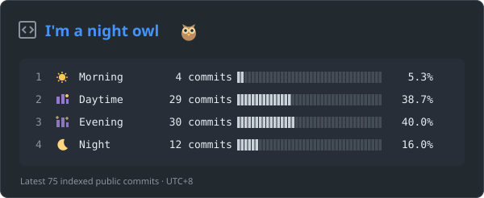

# Commit time

我的 GitHub 公开提交时间分布，按北京时间统计，每天自动更新。



统计 GitHub 已索引的最近最多 1,000 条公开提交，按 SHA 去重。使用作者时间，转换为 UTC+8；不含私有贡献。

| 时段 | 北京时间 |
| --- | --- |
| Morning | 06:00–12:00 |
| Daytime | 12:00–18:00 |
| Evening | 18:00–24:00 |
| Night | 00:00–06:00 |

GitHub Actions 每天 09:23 更新，也可以在 Actions → Update commit time card → Run workflow 手动刷新。计划任务可能延迟；检索失败时保留上一张卡片。

本地更新需要 Python 3.10 或更新版本，只用标准库：

```bash
python3 scripts/update_commit_time.py
```

可通过环境变量 `GITHUB_TOKEN` 提供授权，提高 API 限额。不要把 token 写进代码或提交到仓库。
